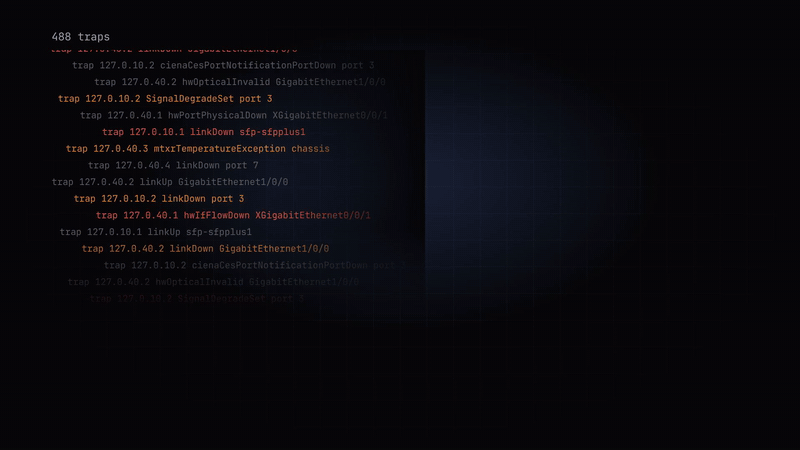

<p align="center">
  
</p>

<h1 align="center">NetCoreNOC</h1>

<p align="center">
  <b>Traps in. Situations out. AI agents on call.</b><br>
  An open-source NOC for telecom networks: it correlates SNMP traps into situations with nothing to
  configure, and AI agents work the cases.
</p>

<p align="center">
  <a href="https://github.com/leonardoSaaads/NetCoreNOC/actions/workflows/ci.yml"></a>
  <a href="LICENSE"></a>
  <a href="https://github.com/leonardoSaaads/NetCoreNOC/releases"></a>
</p>

<p align="center">
  <a href="docs/media/netcorenoc-promo.mp4"></a><br>
  <sub>▶ <a href="docs/media/netcorenoc-promo.mp4">Watch the one-minute video</a>: install on Linux, sign in, a fibre cut becomes one situation, an AI agent works the case.</sub>
</p>

## What it does

* **Broker**: point your equipment's traps at it. It discovers devices and alarm types, groups related
  alarms into **situations**, names the probable root cause and shows *why* each alarm was grouped.
  No MIBs, no inventory, no topology files.
* **NOC**: a situation someone starts working becomes a **case**, with a queue, clocks and a
  customer update. **AI agents** (any OpenAI-compatible model, a local Ollama or Claude) take the
  case, read the devices with read-only commands and keep the customer informed. They lease
  short-lived tokens and never see a password.
* One appliance: three Python processes, PostgreSQL and a web console. No accepted trap is lost to a
  slow model or a restart.

> **Early software.** It has not run in production yet. Run it beside your current NMS first: it
> only needs a copy of the traps.

## Quickstart (Linux, Docker Compose)

```sh
git clone https://github.com/leonardoSaaads/NetCoreNOC.git && cd NetCoreNOC
docker compose up -d --build
docker compose logs netcorenoc | grep -A4 "bootstrap admin"   # the one-time password for `admin`
```

1. Open `http://127.0.0.1:8080/` (or `http://<host>:8080/`), sign in as `admin` and choose a new
   password.
2. Point the devices' **SNMP trap destination** at the host, UDP **162** (v1/v2c; SNMPv3 users go in
   **Settings → SNMP**).
3. Watch **Situations**.

AI agents (optional): switch the top bar to **NOC**. Its Overview lists what is missing, each item a
link: connect a model in **Secrets → AI providers**, hire an agent in **Agents**, and let agents use
each device credential in **Secrets**. No equipment yet? [`docs/simulate.md`](docs/simulate.md)
sends real traps from simulated devices.

Before a team relies on it: an allowlist, HTTPS, one account per person and backups of the database
and both key files ([`docs/operate.md`](docs/operate.md), section 10). A visibility scope narrows
what someone sees, but it is **not tenant isolation** ([`docs/security.md`](docs/security.md)).

## Documentation

| | |
|---|---|
| [`docs/install.md`](docs/install.md) | Every way to install it (Compose, Docker, pip, systemd, Nix) and upgrades |
| [`docs/operate.md`](docs/operate.md) | First sign-in, traps, situations, the NOC and its agents, backups, going to production |
| [`docs/console.md`](docs/console.md) | What each screen is for |
| [`docs/configure.md`](docs/configure.md) | Every setting and its default; the database |
| [`docs/security.md`](docs/security.md) | Accounts, roles, the credential vault, agents, TLS, the audit log |
| [`docs/troubleshoot.md`](docs/troubleshoot.md) | Symptoms and fixes |
| [`docs/README.md`](docs/README.md) | Everything else, including how it works inside |

## Development

```sh
python3.12 -m venv .venv && .venv/bin/pip install -e ".[dev]"
make qa         # lint, type check, tests and the evaluation gate (needs PostgreSQL: `make pg-test-up`)
make dom        # the console's tests (Node 22+)
```

[`CONTRIBUTING.md`](CONTRIBUTING.md) has the rules a change must follow.

## Licence

Apache-2.0, see [LICENSE](LICENSE). Report vulnerabilities privately, as described in
[`SECURITY.md`](SECURITY.md).
